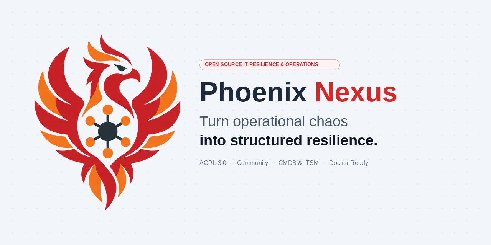
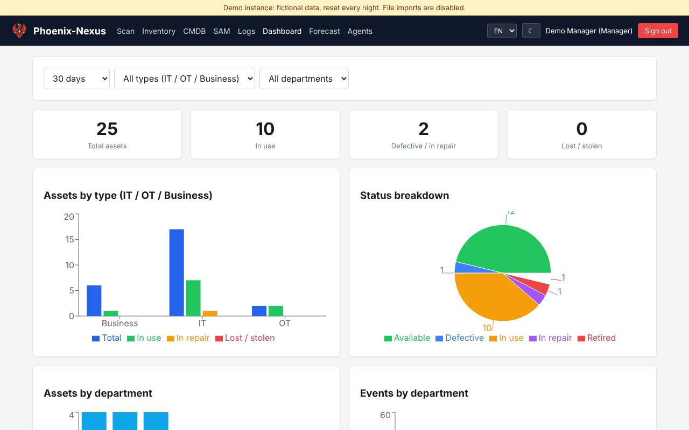
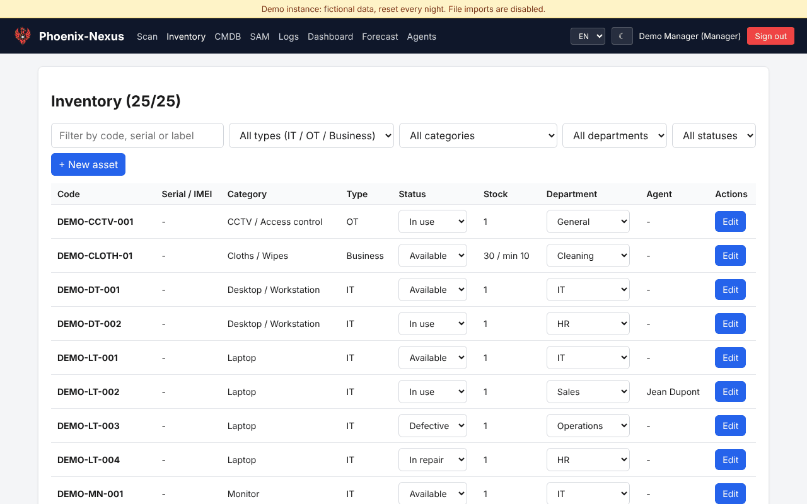
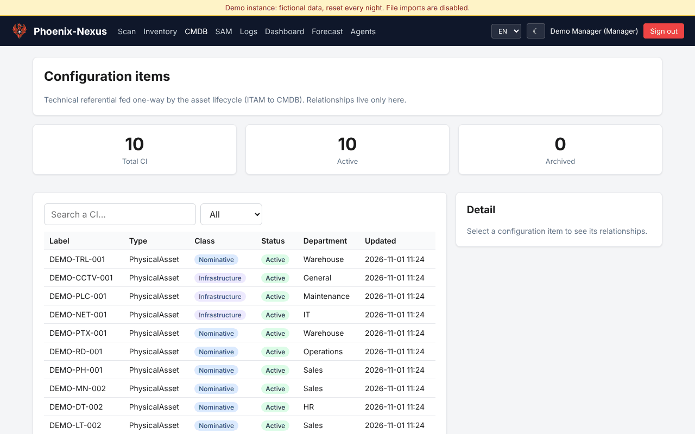
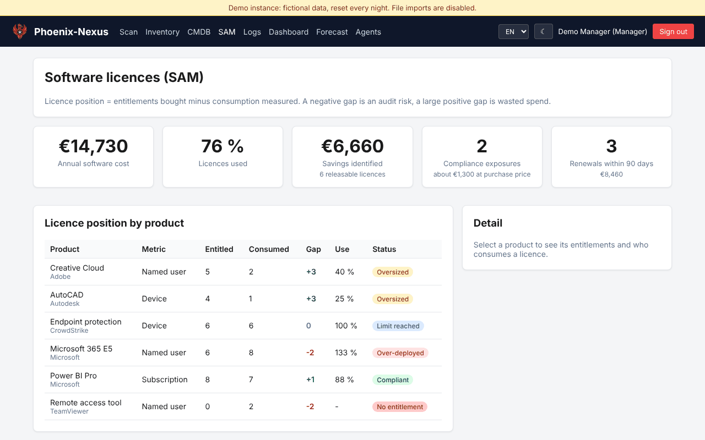

<p align="center">
  <picture>
    <source media="(prefers-color-scheme: dark)" srcset="docs/brand/banner-dark.png">
    
  </picture>
</p>

<p align="center">
  <a href="https://github.com/PhoenixTechMSP/phoenix-nexus/actions/workflows/ci.yml"></a>
  <a href="https://github.com/PhoenixTechMSP/phoenix-nexus/releases"></a>
  <a href="LICENSE"></a>
  <a href="https://demo.phoenix-tech.be"></a>
</p>

<h1 align="center">Phoenix-Nexus</h1>

Self-hosted IT governance platform with three modules on one database:

- **ITAM** - the asset lifecycle for a whole site: the **PTX fleet**, all **IT**
  equipment (laptops, desktops, printers, phones, radios, network gear), all **OT**
  equipment (PLCs, sensors, CCTV, conveyor / BHS) and **business equipment &
  consumables** (vacuum cleaners, trolleys, tools, cloths, PPE, cleaning supplies).
- **CMDB** - configuration items and their relationships, fed one way from the asset
  lifecycle: an asset becomes a configuration item when it enters service and is
  archived (never deleted) when it is retired.
- **SAM** - software licence position (entitlements minus consumption), savings
  identified, compliance exposure and renewals.

Every asset is categorised (`IT` / `OT` / `BUSINESS`), optionally serialised,
assigned to a department, and traceable: who took what, when, returned or not,
in which state, plus repair follow-up and consumable stock levels.

Designed to run **fully offline on your intranet** - no cloud dependency,
one container, one SQLite file.

## Screenshots

Taken on the [live demo](https://demo.phoenix-tech.be) (fictional data, reset every night).

| | |
|---|---|
|  |  |
| **Dashboard**: fleet status, events and forecast | **Inventory**: IT, OT and business equipment, stock alerts |
|  |  |
| **CMDB**: configuration items and relationships | **SAM**: licence position, savings and renewals |

---

## Table of contents

- [Features](#features)
- [Tech stack](#tech-stack)
- [Prerequisites](#prerequisites)
- [Get started](#get-started)
- [Documentation](#documentation)
- [Project layout](#project-layout)
- [Roadmap](#roadmap)
- [License](#license)

---

## Features

- **Asset inventory (ITAM)**: one referential for PTX, IT, OT and business assets.
  Categories are fully manageable in the UI (code, name, kind
  `IT` / `OT` / `BUSINESS`, consumable flag).
- **CMDB**: configuration items created by the asset lifecycle, relationships
  between items (depends on / connected to), archive on retirement. Read-only for
  `staff`, relationships editable by `manager` and `admin`.
- **SAM**: software products, entitlements and assignments; the contract metric
  (named user, device, core, subscription) decides what consumes a licence. Position
  per product (compliant, oversized, limit reached, over-deployed, no entitlement),
  KPIs and renewals within 90 days.
- **Departments** managed in the UI - seeded with General, Operations,
  Warehouse, Sales, HR, Cleaning, IT, Maintenance - create, rename
  or delete your own.
- **QR-code scanning** or manual entry / autocomplete on asset code, serial
  number, IMEI or label (e.g. `PTX-0536 / 356966281334294`).
- **Check-in / check-out** of serialised assets to agents, with autocomplete
  on agents; the department follows the agent.
- **Consumables**: stock quantity, minimum threshold, issue / restock
  operations and a "to reorder" alert list.
- **Asset statuses**: `available`, `in_use`, `defective`, `repair`, `lost`,
  `stolen`, `retired`.
- **Repair follow-up** for any asset: ticket, vendor (freetext - any repair
  provider), sent / returned timestamps, notes.
- **Excel / CSV import** for assets (any category) and agents, with
  duplicate serial/IMEI detection and a downloadable conflict report.
- **Excel exports**: filtered event log, plus a live inventory workbook with
  summaries by type, status, department and category, a consumables stock
  sheet and the full inventory.
- **Reporting dashboard**: day / week / month / year, filterable by asset
  type and department - KPIs, assets per type, per department, per category,
  status distribution, activity trend, low-stock alerts (Recharts).
- **Role-based access**: `admin`, `manager`, `staff`, plus a `pending` state
  for SSO users awaiting approval.
- **Authentication**:
  - Local accounts (email + bcrypt password, JWT sessions).
  - Optional **Microsoft Entra ID SSO** (OpenID Connect). MFA / Yubikey /
    Authenticator is enforced by Microsoft Conditional Access.
- **Multilingual UI**: English (default), French, Dutch.
- **Full audit trail** of every event: create, check-out, check-in, status
  change, repair send / return, stock issue / restock, import.

## Tech stack

| Layer     | Technology                                                    |
|-----------|---------------------------------------------------------------|
| Backend   | Node.js 20, Express 4                                         |
| Database  | SQLite via `better-sqlite3` (WAL mode, foreign keys ON)       |
| Auth      | `bcryptjs` + `jsonwebtoken`; `openid-client` for Entra ID SSO |
| Frontend  | React 18, Vite 5, React Router 6                              |
| Charts    | Recharts                                                      |
| QR / XLSX | `html5-qrcode`, `xlsx` (SheetJS)                              |
| i18n      | `i18next` + `react-i18next` + browser language detector       |
| Packaging | Multi-stage Dockerfile, `docker-compose.yml`                  |

---

## Prerequisites

See [PREREQUISITES.md](PREREQUISITES.md) for the complete list. Short version:

- **Docker install**: Docker Engine 20+ (or Docker Desktop). Nothing else.
- **Node install (no Docker)**: Node.js 20+, plus `python3`, `make`, `g++`
  (Linux) or the Windows build tools - needed to compile `better-sqlite3`.
- **HTTPS reverse proxy** in production (required by the QR camera API and by
  Entra ID SSO redirect URIs).
- **Entra ID SSO (optional)**: a Microsoft 365 tenant plus permission to
  create an App registration.

---

## Get started

Three ways, from the quickest to the most permanent. Docker is the one tested path for 2 and 3.

### 1. Try the live demo (nothing to install)

A public demo is linked in the repository's **About** box. The accounts and their password are shown on its login page.
The data is fictional and reset every night, and file imports are disabled on it.

### 2. Run it on your own machine

With Docker (Docker Desktop on Windows or macOS, Docker Engine on Linux):

```bash
docker run -d --name phoenix-nexus -p 8080:8080 -v phoenix-nexus-data:/data -e SEED_SAMPLE=1 ghcr.io/phoenixtechmsp/phoenix-nexus:2.0.0-alpha.1
docker logs phoenix-nexus
```

Open <http://localhost:8080>. The first start needs no configuration: a strong session secret is generated and kept in the data volume, and an administrator account is created.
`docker logs` shows its email and password **once**. Remove `-e SEED_SAMPLE=1` to start empty instead of with fictional sample data.
To choose the account yourself, add `-e ADMIN_EMAIL=you@example.org -e ADMIN_PASSWORD=<12 characters or more>`.

Without Docker (Node.js 22, see [PREREQUISITES.md](PREREQUISITES.md)):

```bash
npm ci && npm run build
npm run first-admin -- you@example.org 'a-long-password' 'Your Name'
JWT_SECRET=$(openssl rand -hex 32) npm start
```

Use the same `JWT_SECRET` value every time you start the server, otherwise everyone is signed out.

On Windows without Docker, see [INSTALL-WINDOWS.md](INSTALL-WINDOWS.md) (less tested than the Docker path).

### 3. Install it on your server

A Linux server with Docker, and a domain name that points to it. HTTPS is automatic.

```bash
git clone https://github.com/PhoenixTechMSP/phoenix-nexus.git && cd phoenix-nexus/deploy
cp .env.prod.example .env      # set DOMAIN and ACME_EMAIL
docker compose -f docker-compose.prod.yml up -d
docker compose -f docker-compose.prod.yml logs nexus
```

Updates: [UPGRADING.md](UPGRADING.md). Reverse proxy, SSO, backups and troubleshooting: [INSTALL.md](INSTALL.md).
To build from the sources instead of pulling the image: `docker compose up -d --build` (see INSTALL.md).

---

## Documentation

| File                                       | Audience              | Purpose                                                             |
|--------------------------------------------|-----------------------|---------------------------------------------------------------------|
| [README.md](README.md)                     | Everyone              | Overview and quick start (this file).                               |
| [PREREQUISITES.md](PREREQUISITES.md)       | Ops / IT              | System, network and tenant requirements.                            |
| [INSTALL.md](INSTALL.md)                   | Ops / IT              | Docker, Node direct, systemd, Windows/NSSM, Nginx/IIS.              |
| [CONFIGURATION.md](CONFIGURATION.md)       | Ops / IT              | Every environment variable, SSO setup, tenant policies.             |
| [ARCHITECTURE.md](ARCHITECTURE.md)         | Developers            | Code map, data model, request flow, extension points.               |
| [API.md](API.md)                           | Developers            | REST endpoints, request/response shapes, auth model.                |
| [CONTRIBUTING.md](CONTRIBUTING.md)         | Developers            | Local dev setup, coding conventions, PR checklist.                  |
| [SECURITY.md](SECURITY.md)                 | Everyone              | Threat model, hardening checklist, reporting a vulnerability.       |
| [CHANGELOG.md](CHANGELOG.md)               | Everyone              | Versioned change history.                                           |

All documentation is in **English** to keep the project maintainable across
teams. The **end-user UI** ships with EN / FR / NL translations.

---

## Project layout

```text
phoenix-nexus/
├── Dockerfile              # Multi-stage build (Node builder + slim runtime)
├── docker-compose.yml
├── .env.example            # All configurable env vars, documented inline
├── package.json            # Backend + frontend dependencies
├── server/                 # Express backend
│   ├── index.js            # Entry point, static + API mount
│   ├── db.js               # SQLite schema + idempotent migrations
│   ├── middleware/auth.js  # JWT sign/verify + role guards
│   └── routes/             # auth, sso, users, agents, ptx, events, import
├── client/                 # React frontend (built by Vite)
│   ├── index.html
│   ├── vite.config.js
│   └── src/
│       ├── main.jsx        # Router, i18n bootstrap
│       ├── components/     # LanguageSwitcher, Layout, …
│       ├── pages/          # Login, Scan, Inventory, Logs, Dashboard, Admin
│       ├── lib/api.js      # Fetch helper with JWT + error handling
│       └── i18n/           # en.json, fr.json, nl.json
├── scripts/
│   ├── first-admin.js      # CLI to create/reset the first admin
│   └── backup.sh           # SQLite hot backup + 30-day retention
└── data/                   # SQLite DB + backups (mounted volume)
```

---

## Roadmap

Our commitments and the planned work are in [ROADMAP.md](ROADMAP.md).

See [CONTRIBUTING.md](CONTRIBUTING.md) before starting work. Upgrading an existing installation: [UPGRADING.md](UPGRADING.md).

---

## License

Phoenix-Nexus Community is free software under the [GNU Affero General Public License v3.0](LICENSE) (AGPL-3.0-only).

- You can use, study, modify and self-host it, including inside a company, at no cost.
- If you offer a modified version to users over a network (for example as a hosted service), the AGPL requires you to publish your modifications under the same licence.
- A commercial licence is available for organisations that cannot or do not want to comply with the AGPL. See [COMMERCIAL.md](COMMERCIAL.md).

Copyright (C) 2026 Phoenix Tech MSP.

---

## Known limitations

This is an alpha release (`2.0.0-alpha.1`). Be aware of the following before you rely on it:

- **File import (`.xlsx`)** uses a library with a known vulnerability and no upstream fix. Imports are disabled on the public demo. In production, only import files you trust, or use the CSV import.
- **Windows** installation scripts exist but are less tested than the Docker / Linux path.
- **Barcode / QR scanning** with a camera is not covered by automated tests.
- The SQLite database is a single file: plan backups (`scripts/backup.sh`) and use full-disk encryption on the host.
